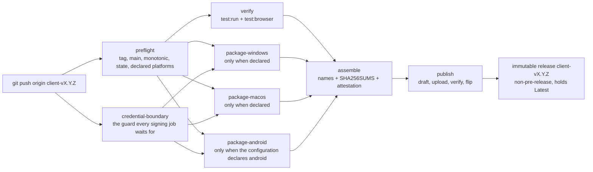

# Client binary release runbook

The Client distributes desktop and Android binaries from GitHub Releases in
`anywear-ai/AnyWear-Client`. One lightweight tag `client-vX.Y.Z` starts
[`client-release.yml`](../.github/workflows/client-release.yml), which builds,
signs, verifies, assembles and publishes one immutable release for that tag. That
release is a non-pre-release and holds the repository's Latest.
This runbook is the operator path for releasing, verifying a download, withdrawing
a release and recording known issues.

Separately, every merge to `main` that changes something outside the documentation
set builds one signed Beta Android APK in
[`client-beta-apk.yml`](../.github/workflows/client-beta-apk.yml) and leaves it as
that run's own 30-day artifact. A merge creates no tag and no release. The same
workflow's manual dispatch may publish one immutable `client-beta.<n>` prerelease
carrying that run's same bytes.

The pipeline mints no App token, holds no AWS identity, declares no GitHub
`environment:` and runs no cloud CLI. Its only release write is `publish`; the only
credential-bearing work is the signing each platform job performs on its own
runner with its own secrets.



## The three channel names

GitHub exposes one `prerelease` boolean and no channel type, so these three tag
names are the only carrier of which channel a build belongs to:

| Name | What it is | Holds Latest |
| --- | --- | --- |
| `client-beta.<n>` | A Beta prerelease this run published on purpose; carries the same `android.apk` and `build-metadata.json` as the run's artifact | Never |
| `client-v<X.Y.Z>-rc.<n>` | The reserved release-candidate name. No workflow builds it today | Not built |
| `client-v<X.Y.Z>` | The formal channel: an immutable release, published as a non-pre-release | Yes |

The `prerelease` flag separates the formal channel from both prerelease channels,
but it cannot separate a beta from a release candidate: that distinction is carried
by the tag name alone, and no workflow, document or reader may infer it from the
flag.

## Beta Android APK from a merge

A merge to `main` whose changed paths are not all Markdown starts
`client-beta-apk.yml`; a merge whose changed paths are all `*.md` starts nothing,
the same rule the web publication follows. The `package-beta-apk` job builds the
Android `release` build type (a Gradle build type, not a GitHub release) against the
same reviewed Beta interface constants the two publication workflows compile, signs
it with the upload keystore, proves the signature, and uploads the artifact. It
creates no tag and no release, and no job that runs on a merge holds
`contents: write`.

| Field | Value |
| --- | --- |
| Workflow | `Build Beta Android APK` (`client-beta-apk.yml`) |
| Jobs | `package-beta-apk` (both events, `contents: read`), `publish-beta-prerelease` (dispatch only, `contents: write`) |
| Artifact | `client-beta-apk-<client_version>-<versionCode>-<short_sha>` |
| Retention | 30 days |
| Artifact contents | `android.apk`, `build-metadata.json`, `SHA256SUMS` |
| `versionName` | `0.0.0-beta.<client_version>.<short_sha>` |

The artifact is developer-facing convenience. It is not a release, not a
distribution channel and not qualification evidence, and nothing treats it as one.
`android.apk` is the exact staged file `apksigner` proved against the keystore
certificate, so the ZIP's bytes are the verified bytes; `SHA256SUMS` carries the
APK's SHA-256 and the run's step summary states the `versionCode`, the
`versionName`, the signer certificate SHA-256 and the APK SHA-256.
`build-metadata.json` is the same schema-3 record the release path publishes, so it
names `source_commit` and `client_version` for the downloaded file.

### The `versionCode` derivation, and why it cannot collide

A build's code is composed from the protocol version and the run identity:

```text
versionCode = client_version * 10_000_000 + run_number * 100 + run_attempt
```

The step admits `client_version` 0 to 209, `run_number` 1 to 99 999 and
`run_attempt` 1 to 99, and fails the job closed outside those bounds. Write
`R = run_number * 100 + run_attempt`; the admitted ranges give `R` in
`[101, 9 999 999]`, strictly below `10^7`. So `client_version = floor(code / 10^7)`
and `R = code mod 10^7` recover the pair, and `run_number = floor(R / 100)` with
`run_attempt = R mod 100` recover the run. The composition is injective, which
covers the three collision cases:

- **Two merges** are two runs and carry different `run_number`, so they differ.
- **Two runs of one commit** are two runs and carry different `run_number`.
- **A re-run of one run** keeps `run_number` and increases `run_attempt`, so it
  collides with neither its own earlier attempt nor any other run.

Ordering holds in both directions that matter: a later merge has a larger
`run_number`, so a larger code, and a re-run of merge `N` (`100N + attempt`, with
`attempt` at most 99) is still below merge `N+1`'s first build (`100N + 101`). The
ceiling is `209 * 10^7 + 9 999 999 = 2 099 999 999`, inside Android's documented
`versionCode` maximum of `2 100 000 000`.

The protocol version sits in the high digits so that every Beta build outranks every
formal release: a release's code is its own `client_version`
(`client-release.yml`'s `Derive the Android versionCode from client_version` step),
so a Beta code is at least `10^7` and every release code is far below it. That is
what makes the cross-channel rule below arithmetic rather than likely.

`github.run_number` is assigned per workflow, so deleting and re-adding
`client-beta-apk.yml` would restart the sequence and could emit a code lower than an
installed build. The file is never deleted or renamed; the eight-file census in
`scripts/entry-surface.node-test.mjs` fails if it disappears.

### The `client-beta.<n>` prerelease, and why a number is never reused

`publish-beta-prerelease` runs only for a manual dispatch. It downloads this run's
artifact by name, resolves `n` as the highest existing `client-beta.<digits>` tag
plus one, creates the tag create-only, and then follows the tag path's own
draft → upload → verify → flip discipline with `--prerelease --latest=false`.

```text
n = max(existing client-beta.<digits> tags) + 1
```

The list is read from `repos/<owner>/<repo>/git/matching-refs/tags/client-beta.`
with pagination, and only a bare `client-beta.<digits>` name contributes a number. A
number is never reused:

- The number is defined as `max(existing) + 1`, so it is strictly greater than every
  tag that exists when it is computed.
- Creation is create-only: `POST /git/refs` returns `422 Reference already exists`
  and the workflow has no force, delete or update path, so two runs that compute the
  same `n` cannot both succeed — the loser fails before any release exists.
- A later dispatch re-reads the tags, sees the tag its predecessor created, and
  takes `n + 1`, so publishing one commit twice yields distinct, increasing numbers.
- A re-run of an attempt that already created its tag recomputes from the now
  existing tag and takes `n + 1`; a race fails it closed rather than overwriting.
- Nothing in the workflow can delete a tag, so a used number is never free again.

A tag whose release creation then fails burns that number: the tag stays, the next
dispatch takes the next number, and the run page records the failure. Two concurrent
dispatches can race for one `n`; the loser fails closed and is re-dispatched.

## Install the merge's Beta APK

For any merge, the routine install path is the run's own artifact:

1. Open the run page — `Actions` → `Build Beta Android APK` → the run for the merge
   — in a browser **signed in to GitHub**. GitHub requires a signed-in account to
   download any Actions artifact, even on this public repository, and offers no
   permanent public artifact URL for one.
2. Download the artifact `client-beta-apk-<client_version>-<versionCode>-<short_sha>`.
   It is a ZIP, **not** installable as downloaded.
3. Extract it. The folder holds `android.apk`, `build-metadata.json` and
   `SHA256SUMS`.
4. Install `android.apk` from the extracted folder through Android's sideload
   prompt, allowing "Install unknown apps" for the app you extracted with.

The artifact is retained **30 days** and has no permanent URL, so after that window
the run page is a record rather than a download; the next merge's artifact is the
newest one, identified by its higher `versionCode`. `build-metadata.json` names the
`source_commit` and `client_version`, and `SHA256SUMS` carries the APK's SHA-256, so
a downloaded APK can be matched to the run and to the certificate.

## Install a published Beta prerelease

When someone chose to publish a merge, the `client-beta.<n>` prerelease page carries
the same `android.apk` as a release asset, so it opens and installs directly from the
phone and the link is permanent. It exists only for the merges someone published on
purpose; the artifact above remains the path for every other merge.

## Moving from a Beta build to a `client-v*` release

The Beta APK and a `client-v*` release APK are one application — one
`applicationId`, one signing key — so a phone holds one of them and compares one
`versionCode`. Every Beta build's code is higher than every release code, so Android
refuses the release install with `INSTALL_FAILED_VERSION_DOWNGRADE`.

The uninstall is a required manual step, not an optional tidy-up: the Beta channel
sits above the release channel by construction, so this is the one direction Android
will not install over. It is the rule the design record's panel recommended over a
second `applicationId` or a shared counter, because one package and one signing key
leave exactly one order of travel.

1. Uninstall the Beta build: `adb uninstall com.anywear.app`, or Settings → Apps →
   AnyWear → Uninstall.
2. Install the release APK.
3. Sign in again.

The uninstall clears the app's local data — the WebView `localStorage` Cognito
tokens and the cached images. Wardrobe and account state are served by the Service
and return after sign-in; the release install is a fresh install. The other
direction needs nothing: a Beta APK always installs over an installed release.
Skipping the uninstall fails the install with the named Android error rather than
leaving a wrong build installed.

## Before the first release (owner preconditions, not pipeline steps)

These are repository settings and operator decisions, not commands the pipeline
runs. They are prerequisites for a signed, immutable release:

1. **Immutable releases enabled** in the repository settings. Published tags and
   assets then cannot be moved, replaced or deleted, and GitHub records its own
   release attestation. The pipeline cannot read this setting (it needs repository
   administration), so enabling it is checked here, out of band, once.
2. **Repository-scoped secrets for the declared platforms.** The repository holds
   nine signing secrets across the two packaging workflows:
   `WINDOWS_CERTIFICATE`, `WINDOWS_CERTIFICATE_PASSWORD`, `APPLE_CERTIFICATE`,
   `APPLE_CERTIFICATE_PASSWORD`, `APPLE_API_KEY_P8`, `ANDROID_KEY_BASE64`,
   `ANDROID_KEYSTORE_PASSWORD`, `ANDROID_KEY_ALIAS`, `ANDROID_KEY_PASSWORD`. The
   declared set decides which are configured: this Beta's `android` set needs the
   four `ANDROID_*`, and only a release that declares `windows` or `macos` requires
   the rest. Which store holds a credential follows what consumes it, not how
   sensitive it is: a credential that publishes into AWS is a publishing credential,
   while a credential that signs bytes is a signing credential and stays in
   repository-scoped secrets, because a packaging job in the tag release run or the
   merge-triggered Beta APK run consumes it. The other five are each read by one
   platform job; the four `ANDROID_*` are read by `package-android` in the tag run
   and by `package-beta-apk` in the Beta run; see
   [CI credentials](source-ci-credentials.md#signing-secrets).
3. **Credentials for the declared platforms.** This Beta declares `android`: its
   upload keystore is generated once with `keytool` and stored base64-encoded in the
   four `ANDROID_*` secrets. A release that declares `macos` also needs an Apple
   Developer ID Application certificate and an App Store Connect API key. The
   reviewed workflow constants `APPLE_SIGNING_IDENTITY`, `APPLE_TEAM_ID`,
   `APPLE_API_ISSUER`, `APPLE_API_KEY` and `WINDOWS_TIMESTAMP_URL` carry the public
   values; changing them is a reviewed workflow change.

   The Windows and macOS legs need a non-exportable key — in a hardware module, a
   cloud key-protection service or a signing service. That is a different signing
   mechanism, not a different store: what the repository holds may become a
   signing-service credential while it is still a build credential read by the
   packaging job.

   The Windows OV `.pfx` is **not** an admitted mechanism. Since 2023-06-01 the
   CA/Browser Forum *Code Signing Baseline Requirements* require a subscriber's
   private key to be generated, stored and used in a hardware module, a cloud
   key-protection service or a signing service, and `Import-PfxCertificate` needs
   the private key exported out of exactly that hardware boundary. The Windows leg
   is therefore deferred for the Beta; choosing a replacement signer is a separate
   decision. The job, its asset name and its signature check stay in the workflow,
   skipped because the configuration does not declare `windows`.
4. **Platform list**: `client-release-platforms.json` at the repository root is the
   single source of the declared set. `preflight` reads it once and prints
   `platforms=` plus one boolean per platform, and every later job reads those
   outputs. A platform it names is built; a platform it does not name is skipped and
   recorded `not_published (platform_not_enabled)`. Declaring `android` also requires
   the committed `src-tauri/gen/android` project — `preflight` refuses the
   declaration without it. The committed set for this Beta is `["android"]`.

## Releasing

1. Confirm the commit to publish is on `main`, has been reviewed and merged, and
   that `client-version.json` satisfies the repository's commit-level version-bump
   check (`scripts/assert-client-version-bump.mjs`, compared with `origin/main` or
   `github.event.before`; it permits equality). The release-level rule below is a
   different rule.
2. Add or update `docs/client-release-notes/client-v<X.Y.Z>.md` and merge it. The
   file must be non-empty Markdown, contain a `## Known issues` heading, and carry a
   `## Platform availability` section with exactly one labelled line per platform:
   `- **Windows:**`, `- **macOS:**` and `- **Android:**`. A platform the
   configuration declares must read `published`; one it does not declare must read
   `not_published (platform_not_enabled`, with the reason after it. `preflight` and
   `node scripts/assert-client-release.mjs verify --tag client-v<X.Y.Z>` both refuse
   notes that miss, repeat or contradict a platform.
3. Create and push a **lightweight** tag. An annotated tag is refused by
   `preflight`; this repository does not dereference tags in CI.

   ```bash
   git tag client-v0.2.0
   git push origin client-v0.2.0
   ```

4. Watch the run:

   ```bash
   gh run list --repo anywear-ai/AnyWear-Client --workflow client-release.yml
   gh run watch <run-id> --repo anywear-ai/AnyWear-Client
   ```

5. The pipeline takes over: `preflight` validates identity, state and the declared
   platform set, `verify` runs the tests on the tagged revision, each declared
   platform job checks its own secrets and signs and verifies its own binary,
   `assemble` asserts the declared platforms and the 2 GiB single-file limit,
   writes `SHA256SUMS` and one attestation, and `publish` creates a draft, uploads,
   checks the checksums back, flips it to a non-pre-release holding Latest and
   proves that the repository's Latest names the tag.
6. Hand the Release link to testers.

There is no manual dispatch, so the only recovery is a re-run:

```bash
gh run rerun <run-id> --repo anywear-ai/AnyWear-Client
```

A re-run is safe because `preflight` classifies the existing release into one of
four states:

| State | Condition | What the pipeline does |
| --- | --- | --- |
| `absent` | No release and no tag collision for the commit | Builds and publishes |
| `draft` | A draft release exists for this tag | Adopts the draft: purges and replaces its assets, then publishes |
| `published`, complete | A published release whose assets equal the declared set | Downloads the release's own `SHA256SUMS` and verifies every listed digest; ends green only when they all match, without rebuilding; no second release |
| `published`, incomplete | A published release missing a declared asset | Hard refusal: an immutable release cannot be patched in place; withdraw it and cut a patch |

### Release-level monotonicity

The release version is the tag's `X.Y.Z`. `preflight` requires it to be **strictly
greater** than the highest other `client-v*` tag; equality is refused, because one
version must not be published twice. This is separate from the commit-level
`client_version` bump check, which compares `client-version.json` with
`origin/main` or the push's `before` revision and allows equality (ADR 0026).

Version tags are never moved or reused. A failed or bad release is superseded by a
new, strictly higher patch version; a withdrawn version's name stays burned even
after its Release is delisted, because the Git tag remains.

## Download and verify

Download the assets — the repository is public, so no login is needed:

```bash
gh release download client-v0.2.0 --repo anywear-ai/AnyWear-Client --dir anywear-client-0.2.0
```

or open `https://github.com/anywear-ai/AnyWear-Client/releases/tag/client-v0.2.0`.

### 1. Checksums

`SHA256SUMS` is GNU coreutils text mode: `<64 lowercase hex><two spaces><basename>`
per line, LF, sorted with `LC_ALL=C`, no header, no directory prefix, and no line
for the file itself.

Linux:

```bash
cd anywear-client-0.2.0
sha256sum -c SHA256SUMS
```

macOS:

```bash
cd anywear-client-0.2.0
shasum -a 256 -c SHA256SUMS
```

Windows PowerShell, comparing every line:

```powershell
Get-Content SHA256SUMS | ForEach-Object {
  $digest, $name = $_ -split '  ', 2
  $actual = (Get-FileHash -Algorithm SHA256 -Path $name).Hash.ToLower()
  if ($actual -ne $digest) { throw "$name does not match SHA256SUMS" }
}
```

### 2. Provenance

One Sigstore bundle, `SHA256SUMS.sigstore.json`, attests every artifact listed in
`SHA256SUMS`. Verify it against a trust root you obtained independently of this
download (for example from the GitHub CLI's attestation trusted-root output or
Sigstore's published trusted root), never from a file that came with the release
you are checking:

```bash
gh attestation verify --bundle SHA256SUMS.sigstore.json --repo anywear-ai/AnyWear-Client \
  --signer-workflow anywear-ai/AnyWear-Client/.github/workflows/client-release.yml \
  --source-ref refs/tags/client-v0.2.0 \
  --source-digest <the tag commit sha> \
  --custom-trusted-root trusted_root.jsonl
```

The trust root must be obtained independently of the same download; a file
downloaded beside the artifact it certifies proves nothing about the delivery path.

The verified claim is an origin claim: these exact bytes were produced by this
repository from this commit for this tag. It does not prove the binary harmless,
does not prove the source builds reproducibly to the same bytes, and does not prove
the release is still recommended or not withdrawn — that last fact is only on the
live Release page (§ Withdrawal).

### 3. Native signatures

The Beta publishes Android only. The desktop examples apply to a release whose
configuration declares that platform.

Windows (PowerShell). `Status` must be `Valid`:

```powershell
Get-AuthenticodeSignature -FilePath .\AnyWear-0.2.0-windows-x64-setup.exe | Format-List Status, StatusMessage, SignerCertificate
```

macOS. Both commands must pass:

```bash
codesign -vvv --strict --deep AnyWear.app
spctl -a -vvv -t exec AnyWear.app
```

Android (this Beta's published platform):

```bash
apksigner verify --print-certs AnyWear-0.2.0-android.apk
jarsigner -verify AnyWear-0.2.0-android.aab
```

Both packages are signed by the `release` build type, which reads
`src-tauri/gen/android/keystore.properties` — the file `package-android`
materializes from the four `ANDROID_*` secrets, with the store type it detects
from the keystore itself — so a checkout without that file configures the same
project unsigned for local work.

`build-metadata.json` is packed inside the application (`frontendDist: ../dist`),
so a tester holding only the app can read `source_commit`, `client_version` and the
compiled API interface without any network call. It carries no `X.Y.Z` field; the
tag and the installer metadata carry the release version, `client-version.json` and
the installed app carry the protocol version.

## Known issues

Known issues live in the committed `docs/client-release-notes/client-v<X.Y.Z>.md`,
which `preflight` requires before the tag can publish. The same file is attached as
the immutable asset `RELEASE-NOTES.md`, so the limitations recorded at publication
time cannot be quietly rewritten afterwards.

- **Before tagging**: edit the file, include the `## Known issues` heading and the
  `## Platform availability` block described under § Releasing, merge it, then tag.
  `node scripts/assert-client-release.mjs verify --tag client-v<X.Y.Z>` checks both
  sections and the declared set locally, without a tag or a network.
- **After publication**: treat `RELEASE-NOTES.md` as a snapshot. Current operational
  advice, withdrawal banners and pointers to a replacement version go on the
  mutable GitHub Release body, which is the part testers read first.

## Withdrawal

Withdrawal is an operator action, never a pipeline action. The workflow contains no
release deletion and cannot edit a published release. There are two classes:

| Class | Applies to | Command | Result |
| --- | --- | --- | --- |
| **Demote and annotate** | Quality or correctness defects | `gh release edit client-vX.Y.Z --repo anywear-ai/AnyWear-Client --prerelease --latest=false --notes-file withdrawn-client-vX.Y.Z.md` | Downloads stay reachable; the page leads with the defect and points to the replacement version. The command also stops the release holding Latest, so the demoted version no longer leads the Releases page |
| **Delist** | Security defects, where the download itself is the hazard | `gh release delete client-vX.Y.Z --repo anywear-ai/AnyWear-Client --yes` | The Release disappears and the assets are no longer downloadable; the Git tag remains as the permanent record that the version existed and was withdrawn |

Delist **without** `--cleanup-tag`: the tag keeps the version name burned so it can
never be reused. Both classes finish with a normal release of `client-vX.Y.(Z+1)`.

If a re-run finds a published but incomplete release, it refuses: an immutable
release cannot be patched in place, so the operator withdraws it by one of the two
classes above and cuts the next patch.

## Rollback

There is no staging channel for binaries — the Release is the distribution channel
— so re-promotion is not defined and no release is ever rebuilt or re-promoted.
Rollback means:

1. Point testers at the previous `client-v*` release that is still valid, and say
   so in the withdrawn version's notes.
2. To actually restore old behavior, cut a **strictly higher** patch from a revert
   commit. `client_version` under ADR-0026 is monotonic and compiled into the
   Service's `MINIMUM_CLIENT_VERSION`; an older binary can be rejected with
   `HTTP 400 CLIENT_VERSION_UNSUPPORTED`, and lowering the Service floor rejects
   every older client, so it is a last resort rather than a rollback path.

## Boundaries this runbook relies on

- `client-release.yml` is triggered only by `push: tags: ['client-v[0-9]*']`. The
  repository's two manual dispatch surfaces are `release.yml` (the web publication)
  and `client-beta-apk.yml` (the optional Beta prerelease publish); neither one can
  publish a formal client release.
- The concurrency group `client-release-publish` serializes tags;
  `cancel-in-progress: false` keeps an in-flight upload alive.
- `publish` creates the Release as a draft, uploads with no overwrite flag, checks
  the uploaded bytes with `sha256sum -c`, and only then flips the draft. The
  published readback asserts that the release is not a draft and not a prerelease,
  that the repository's Latest release names the tag, and the asset inventory
  against the declared platform list.
- `assemble` refuses an asset of 2 GiB or more (GitHub requires every release file
  to be under that limit) and reports the set's total before upload, so an
  oversized installer stops the run with no Release.
- The pipeline never asserts `isImmutable`; that setting is an administrative
  precondition recorded above, not a `contents: write` read.
- `client-release.yml` creates or moves no tag, deletes no release, and edits no
  release before the flip.
- The merge path in `client-beta-apk.yml` creates no tag and no release: a merge
  leaves only that run's 30-day artifact. The workflow's only `contents: write`
  holder is `publish-beta-prerelease`, which a merge cannot run, and its only tag
  write is the create-only `client-beta.<n>` ref, which a merge never reaches.
