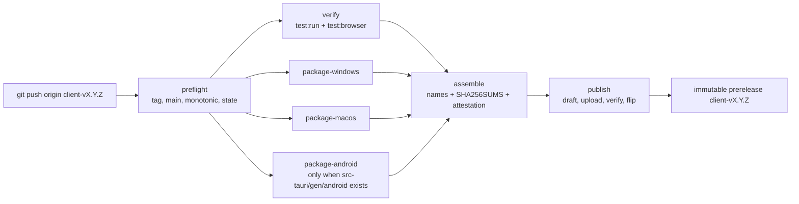

# Client binary release runbook

The Client distributes desktop and Android binaries from GitHub Releases in
`anywear-ai/AnyWear-Client`. One lightweight tag `client-vX.Y.Z` starts
[`client-release.yml`](../.github/workflows/client-release.yml), which builds,
signs, verifies, assembles and publishes one immutable prerelease for that tag.
This runbook is the operator path for releasing, verifying a download, withdrawing
a release and recording known issues.

The pipeline mints no App token, holds no AWS identity, declares no GitHub
`environment:` and runs no cloud CLI. Its only release write is `publish`; the only
credential-bearing work is the signing each platform job performs on its own
runner with its own secrets.



## Before the first release (owner preconditions, not pipeline steps)

These are repository settings and purchases, not commands the pipeline runs. They
are prerequisites for a signed, immutable release:

1. **Immutable releases enabled** in the repository settings. Published tags and
   assets then cannot be moved, replaced or deleted, and GitHub records its own
   release attestation. The pipeline cannot read this setting (it needs repository
   administration), so enabling it is checked here, out of band, once.
2. **Nine repository-scoped secrets configured**: `WINDOWS_CERTIFICATE`,
   `WINDOWS_CERTIFICATE_PASSWORD`, `APPLE_CERTIFICATE`, `APPLE_CERTIFICATE_PASSWORD`,
   `APPLE_API_KEY_P8`, `ANDROID_KEY_BASE64`, `ANDROID_KEYSTORE_PASSWORD`,
   `ANDROID_KEY_ALIAS`, `ANDROID_KEY_PASSWORD`. Each is read by one platform job;
   see [CI credentials](source-ci-credentials.md#signing-secrets).
3. **Certificates procured**: a Windows OV code-signing `.pfx`, an Apple Developer
   ID Application certificate and an App Store Connect API key. The reviewed
   workflow constants `APPLE_SIGNING_IDENTITY`, `APPLE_TEAM_ID`,
   `APPLE_API_ISSUER`, `APPLE_API_KEY` and `WINDOWS_TIMESTAMP_URL` carry the public
   values; replace the placeholders in `client-release.yml` when the certificates
   are bought. Changing them is a reviewed workflow change.
4. **Platform list**: `windows` and `macos` are always declared. `android` joins the
   declared list only when the tag's commit contains `src-tauri/gen/android`, which
   #279 produces. A platform staying out of the list is an operator decision made
   by not having the project or by reviewing the list out, and the release notes
   record `not_published (platform_not_enabled)`.

## Releasing

1. Confirm the commit to publish is on `main`, has been reviewed and merged, and
   that `client-version.json` satisfies the repository's commit-level version-bump
   check (`scripts/assert-client-version-bump.mjs`, compared with `origin/main` or
   `github.event.before`; it permits equality). The release-level rule below is a
   different rule.
2. Add or update `docs/client-release-notes/client-v<X.Y.Z>.md` and merge it. The
   file must be non-empty Markdown and contain a `## Known issues` heading;
   `preflight` refuses the tag without it.
3. Create and push a **lightweight** tag. An annotated tag is refused by
   `preflight`; this repository does not dereference tags in CI.

   ```bash
   git tag client-v0.1.0
   git push origin client-v0.1.0
   ```

4. Watch the run:

   ```bash
   gh run list --repo anywear-ai/AnyWear-Client --workflow client-release.yml
   gh run watch <run-id> --repo anywear-ai/AnyWear-Client
   ```

5. The pipeline takes over: `preflight` validates identity and state, `verify`
   runs the tests on the tagged revision, the three platform jobs check their own
   secrets and sign and verify their own binaries, `assemble` asserts the declared
   platforms and the 2 GiB single-file limit, writes `SHA256SUMS` and one
   attestation, and `publish` creates a draft, uploads, checks the checksums back,
   flips it to a prerelease and reads it back.
6. Hand the Release link to testers.

There is no manual dispatch, so the only recovery is a re-run:

```bash
gh run rerun <run-id> --repo anywear-ai/AnyWear-Client
```

A re-run is safe because `preflight` classifies the existing release into one of
four states:

| State | Condition | What the pipeline does |
| --- | --- | --- |
| `absent` | No release and no tag collision for the commit | Builds and publishes |
| `draft` | A draft release exists for this tag | Adopts the draft: purges and replaces its assets, then publishes |
| `published`, complete | A published release whose assets equal the declared set | Downloads the release's own `SHA256SUMS` and verifies every listed digest; ends green only when they all match, without rebuilding; no second release |
| `published`, incomplete | A published release missing a declared asset | Hard refusal: an immutable release cannot be patched in place; withdraw it and cut a patch |

### Release-level monotonicity

The release version is the tag's `X.Y.Z`. `preflight` requires it to be **strictly
greater** than the highest other `client-v*` tag; equality is refused, because one
version must not be published twice. This is separate from the commit-level
`client_version` bump check, which compares `client-version.json` with
`origin/main` or the push's `before` revision and allows equality (ADR 0026).

Version tags are never moved or reused. A failed or bad release is superseded by a
new, strictly higher patch version; a withdrawn version's name stays burned even
after its Release is delisted, because the Git tag remains.

## Download and verify

Download the assets — the repository is public, so no login is needed:

```bash
gh release download client-v0.1.0 --repo anywear-ai/AnyWear-Client --dir anywear-client-0.1.0
```

or open `https://github.com/anywear-ai/AnyWear-Client/releases/tag/client-v0.1.0`.

### 1. Checksums

`SHA256SUMS` is GNU coreutils text mode: `<64 lowercase hex><two spaces><basename>`
per line, LF, sorted with `LC_ALL=C`, no header, no directory prefix, and no line
for the file itself.

Linux:

```bash
cd anywear-client-0.1.0
sha256sum -c SHA256SUMS
```

macOS:

```bash
cd anywear-client-0.1.0
shasum -a 256 -c SHA256SUMS
```

Windows PowerShell, comparing every line:

```powershell
Get-Content SHA256SUMS | ForEach-Object {
  $digest, $name = $_ -split '  ', 2
  $actual = (Get-FileHash -Algorithm SHA256 -Path $name).Hash.ToLower()
  if ($actual -ne $digest) { throw "$name does not match SHA256SUMS" }
}
```

### 2. Provenance

One Sigstore bundle, `SHA256SUMS.sigstore.json`, attests every artifact listed in
`SHA256SUMS`. Verify it against a trust root you obtained independently of this
download (for example from the GitHub CLI's attestation trusted-root output or
Sigstore's published trusted root), never from a file that came with the release
you are checking:

```bash
gh attestation verify --bundle SHA256SUMS.sigstore.json --repo anywear-ai/AnyWear-Client \
  --signer-workflow anywear-ai/AnyWear-Client/.github/workflows/client-release.yml \
  --source-ref refs/tags/client-v0.1.0 \
  --source-digest <the tag commit sha> \
  --custom-trusted-root trusted_root.jsonl
```

The trust root must be obtained independently of the same download; a file
downloaded beside the artifact it certifies proves nothing about the delivery path.

The verified claim is an origin claim: these exact bytes were produced by this
repository from this commit for this tag. It does not prove the binary harmless,
does not prove the source builds reproducibly to the same bytes, and does not prove
the release is still recommended or not withdrawn — that last fact is only on the
live Release page (§ Withdrawal).

### 3. Native signatures

Windows (PowerShell). `Status` must be `Valid`:

```powershell
Get-AuthenticodeSignature -FilePath .\AnyWear-0.1.0-windows-x64-setup.exe | Format-List Status, StatusMessage, SignerCertificate
```

macOS. Both commands must pass:

```bash
codesign -vvv --strict --deep AnyWear.app
spctl -a -vvv -t exec AnyWear.app
```

Android (after #279 produces the project and the first APK):

```bash
apksigner verify --print-certs AnyWear-0.1.0-android.apk
```

`build-metadata.json` is packed inside the application (`frontendDist: ../dist`),
so a tester holding only the app can read `source_commit`, `client_version` and the
compiled API interface without any network call. It carries no `X.Y.Z` field; the
tag and the installer metadata carry the release version, `client-version.json` and
the installed app carry the protocol version.

## Known issues

Known issues live in the committed `docs/client-release-notes/client-v<X.Y.Z>.md`,
which `preflight` requires before the tag can publish. The same file is attached as
the immutable asset `RELEASE-NOTES.md`, so the limitations recorded at publication
time cannot be quietly rewritten afterwards.

- **Before tagging**: edit the file, include at least a `## Known issues` heading,
  merge it, then tag. `node scripts/assert-client-release.mjs verify --tag
  client-v<X.Y.Z>` checks the file locally without a tag or a network.
- **After publication**: treat `RELEASE-NOTES.md` as a snapshot. Current operational
  advice, withdrawal banners and pointers to a replacement version go on the
  mutable GitHub Release body, which is the part testers read first.

## Withdrawal

Withdrawal is an operator action, never a pipeline action. The workflow contains no
release deletion and cannot edit a published release. There are two classes:

| Class | Applies to | Command | Result |
| --- | --- | --- | --- |
| **Demote and annotate** | Quality or correctness defects | `gh release edit client-vX.Y.Z --repo anywear-ai/AnyWear-Client --prerelease --latest=false --notes-file withdrawn-client-vX.Y.Z.md` | Downloads stay reachable; the page leads with the defect and points to the replacement version |
| **Delist** | Security defects, where the download itself is the hazard | `gh release delete client-vX.Y.Z --repo anywear-ai/AnyWear-Client --yes` | The Release disappears and the assets are no longer downloadable; the Git tag remains as the permanent record that the version existed and was withdrawn |

Delist **without** `--cleanup-tag`: the tag keeps the version name burned so it can
never be reused. Both classes finish with a normal release of `client-vX.Y.(Z+1)`.

If a re-run finds a published but incomplete release, it refuses: an immutable
release cannot be patched in place, so the operator withdraws it by one of the two
classes above and cuts the next patch.

## Rollback

There is no staging channel for binaries — the Release is the distribution channel
— so re-promotion is not defined and no release is ever rebuilt or re-promoted.
Rollback means:

1. Point testers at the previous `client-v*` release that is still valid, and say
   so in the withdrawn version's notes.
2. To actually restore old behavior, cut a **strictly higher** patch from a revert
   commit. `client_version` under ADR-0026 is monotonic and compiled into the
   Service's `MINIMUM_CLIENT_VERSION`; an older binary can be rejected with
   `HTTP 400 CLIENT_VERSION_UNSUPPORTED`, and lowering the Service floor rejects
   every older client, so it is a last resort rather than a rollback path.

## Boundaries this runbook relies on

- The workflow is triggered only by `push: tags: ['client-v[0-9]*']`; `release.yml`
  remains the only manual dispatch surface in the repository.
- The concurrency group `client-release-publish` serializes tags;
  `cancel-in-progress: false` keeps an in-flight upload alive.
- `publish` creates the Release as a draft, uploads with no overwrite flag, checks
  the uploaded bytes with `sha256sum -c`, and only then flips the draft. The
  readback asserts draft state, prerelease flag, tag name and the asset inventory
  against the declared platform list.
- `assemble` refuses an asset of 2 GiB or more (GitHub requires every release file
  to be under that limit) and reports the set's total before upload, so an
  oversized installer stops the run with no Release.
- The pipeline never asserts `isImmutable`; that setting is an administrative
  precondition recorded above, not a `contents: write` read.
- No workflow creates or moves a tag, deletes a release, or edits a release before
  the flip.
